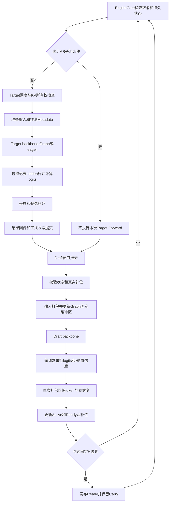

# CDB AV 当前路径的深入底层审计

当前312.565±0.499 tok/s与历史原生341.073±5.497之间的差距，不能统一解释为CPU、传输或GEMM低效。本轮沿源码调用链重新关联CPU范围、CUDA API、GPU活动、数据搬运和状态依赖，确认了Target采样中两类具体冗余，也排除了若干被包含时间夸大的瓶颈。没有新增GPU运行或性能对照，没有改变H、HF和等待队列语义。

审计对象为已验收源码73d37c98，Llama 8B/1B、BF16、FA2、TP1、H8、HF0.8、cap8、C16、单次Target上限4、等待队列开启。正式工作量来自三轮512请求；时间线来自完整512请求测量中段的64次Target、151次Draft采样。采样有Profiler扰动，不能把其中包含时间直接当作正常运行的可回收开销。

## 实际执行链与依赖

Target与Draft在当前定义下顺序执行。Draft下一步是否继续以及哪个槽位可补位，依赖本步HF置信度和token；Target状态提交也依赖验证结果。存在依赖的结果可见性同步不能简单删除。Worker的collective_rpc为UniProc同进程调用；API前端到EngineCore另有进程边界，不能把所有RPC标签解释为网络往返。

## CPU包含时间中有多少是在等GPU

本次把嵌套CDB范围从父范围中扣除，再将阻塞API区间与已记录的GPU kernel及memcpy活动区间做交集。区间交集使用同一Kineto时间线，GPU活动先合并以避免重叠累加。

| 范围 | 次数 | CPU包含时间ms | 扣除嵌套CDB后ms |
| --- | ---: | ---: | ---: |
| Target sampling | 64 | 958.913 | 958.913 |
| Draft step及sampling | 151 | 763.751 | 511.276 |
| Target forward主机范围 | 64 | 300.518 | 287.542 |
| Worker RPC全部操作 | 439 | 2281.499 | 115.806 |
| 等待队列刷新 | 602 | 87.389 | 57.261 |
| Draft输入打包 | 151 | 48.057 | 48.057 |
| Target输入准备 | 64 | 62.940 | 32.873 |
| Target推测Metadata | 61 | 25.723 | 25.723 |
| Target状态更新 | 64 | 25.267 | 25.267 |
| Target注意力Metadata | 64 | 13.042 | 13.042 |

扣除嵌套范围后仍可能包含Torch内部调用、GPU等待、框架与Profiler成本，不能改称“纯Python开销”。尤其不能把这些CPU时间与GPU时间相加。

| 阻塞回传范围 | API CPU时间ms | 与GPU活动重叠ms | GPU实际拷贝ms |
| --- | ---: | ---: | ---: |
| Target pageable DtoH，61次 | 905.761 | 902.490，99.64% | 0.066 |
| Draft pageable DtoH，151次 | 413.831 | 408.069，98.61% | 0.168 |

这两项长API时间绝大部分与前序GPU工作重叠，不能用“改异步回传”就认领相等收益。回传的数据量本身很小。Target另有3次pinned回传和Event等待，完整数据单列在JSON中。

显式cudaStreamSynchronize在Target采样61次约0.197ms、Draft151次约0.435ms；23次cudaDeviceSynchronize合计约0.680ms。它们与隐含在pageable回传内的等待不同。只搜索Synchronize名称会漏掉主要等待；把DtoH全部叫传输成本则会反向高估。

尚未覆盖的API前端排队、完整请求尾部和采样扰动，使本结果不足以对整轮约27秒差距做精确因果分账。本轮也没有把trace未覆盖区间直接称作硬件idle。

## 输入与Metadata的复制和分配链

Draft每步从成员状态重建token、位置、block rows、query长度、slot和最后一行索引。Pinned stager验证尺寸和范围，在可复用host缓冲区编码，再申请本步GPU payload并做一次HtoD。随后：

1. token及position复制到proposer固定模型输入缓冲区。
2. Graph将当前query offsets、block table、seq lengths和slots更新到捕获时固定的Metadata存储。
3. Graph使用固定地址和当步的真实映射执行。

Target同样在重放前逐字段更新固定Metadata，再复制ids与positions。标量域、shape、dtype、device、Storage和KV所有权守卫仍在执行。

| 采样中的实际GPU搬运 | 次数 | 字节 | GPU时间ms |
| --- | ---: | ---: | ---: |
| Draft打包后的pinned HtoD | 151 | 86080 | 0.055 |
| Target输入准备pinned HtoD | 445 | 76092 | 0.153 |
| Target推测Metadata pageable HtoD | 305 | 11208 | 0.105 |
| Draft forward内DtoD | 306 | 13056 | 0.288 |
| Draft Graph Metadata DtoD | 380 | 9632 | 0.355 |
| Target forward内DtoD | 330 | 67984 | 0.334 |

所有HtoD合计GPU时间约0.385ms，相比模型计算很小。小拷贝的调用次数和CPU构造仍可能有成本，但历史Metadata合包实验没有证明端到端收益，不能仅看到调用多就重跑。

这里有一个尚未单独量化的实现机会：本步GPU payload分配、临时字段view以及固定输入/Metadata之间的中间存储。复用GPU缓冲区必须证明前一使用已结束、没有仍被Graph引用的临时存储、没有跨行别名和增长覆盖。直接将Graph指针换成当步payload、删除事件或所有权检查是不安全的。本轮确认了生命周期路径，没有证明某次复制可以无条件删除。

## logits行选择与Target采样的具体冗余

源码核对结果如下：

- Draft混合Prefill/Decode在backbone后按每请求last_indices选择hidden，再调用LM head；单query Decode本身一行对应一个请求。未发现对完整Prefill的所有中间token计算词表投影。
- Target在compute_logits前使用logits_indices；草稿验证需要各候选位置以及bonus位置的分布。不能直接把这些验证行裁成每请求末行，否则改变接受/拒绝语义。
- HF置信度计算需要完整词表归一化，当前max与logsumexp后把token、confidence打包，只进行一次小结果回传。不能用截断词表或近似置信度冒充等价底层优化。

在Target rejection_sampler中找到两处具体冗余：

**未请求logprobs时仍复制raw logits。** raw-logprobs模式分支在apply_logits_processors前clone整块候选logits，但后续读取原始logits的logprobs代码只有在max_num_logprobs不为None时才执行。当前trace中Target sampling有61次DtoD，合计294475776字节、GPU时间0.262ms；与全词表矩阵复制路径相符。这为按请求能力缩小clone分支提供了源码和运行证据。另有同类路径：bonus采样无论外层是否请求logprobs，都被强制设置max_num_logprobs=-1以保存完整raw/processed logits；这些额外结果只在外层logprobs分支被消费。BF16 raw_logits路径会先为保存raw结果转换一次FP32，再为实际采样转换一次，值得在不需要返回logprobs时取消额外保存。GPU直接搬运成本很小，CPU分配成本尚需单独量化，不能宣称大幅收益。

**全贪婪验证仍softmax后argmax。** apply_sampling_constraints在all_greedy时原样返回logits，但随后仍生成完整target_probs，rejection_sample再取target_probs.argmax。理论排序通常可由logits给出，但浮点归一化可能把极近值舍入为并列，NaN/Inf及并列选择也需保持原行为。实施前必须给出兼容条件和精确回退，并覆盖混合greedy/random、logprobs和processor分支。此项不是修改Draft HF0.8，二者不能混淆。

Target sampling全部GPU kernel时间仅约5.809ms，不能因该CPU范围包含约959ms就预估近1秒的可节省量。这两处是可实现的精确分支候选，当前证据支持其存在，不支持它们单独填平8.358%的系统差距。

## KV增量复用与清理

当前三轮正式日志内部区间合计复用22067005个逻辑前缀token，实际补充Prefill为311674；复用占两者合计约98.61%。该计数不是GPU字节数，也未覆盖日志边界尾部，但不支持“当前多数Draft上下文每轮都完整重算”的解释。

清理方面，Carry按原KV lineage恢复，取消/抢占会使对应状态失效；Drop/Reset需Worker确认后才释放CPU allocator拥有的页。缓存lease重新转交、审核页释放和失败回滚均有明确协议。不能通过缩减这些断言制造微测收益。

采样clear_slots相关memset/kernel GPU成本很小，显式CPU同步总量也小。没有证据支持将KV清零视为当前首要瓶颈。下一项有价值的KV审查应统计失去复用的原因及对应代价，不能仅重复开启已有复用开关。

## Graph覆盖和实际模型计算

正式日志内部区间Target调用28544，replay23600、budget回退3504、layout回退1440；未覆盖边界尾部。中段采样中为55次replay、6次budget、3次layout，Draft147次Graph、4次eager。两种统计范围不同，不混算百分比。

缓存增加24到32已有历史否定结果，并按用户要求停止了新复测。本轮没有再次启动。兼容bound复用、简单padding、默认BLAS切换、已否定布局等也不重新试探。

相邻内核审计已确认Target/Draft backbone中GEMM占94.36%/85.97%。真实层权重与有限cuBLASLt算法搜索未见明显可集成收益。字节等价速率不能证明带宽饱和；有限算法枚举也不能证明全部内核最优。当前小批次下，减少输入行未带来同比减少的单次执行成本，因而每次模型执行的产出和是否存在重复执行都很重要。

本轮未发现“同一调度结果意外执行两次backbone”的证据。正式Target observer计数与实际iteration指标一致，Draft dispatch有实际执行关联；Graph捕获和诊断参考执行须与正式重放区分。若未来提出合并模型调用，必须先证明没有跨越HF停止、固定H发布或KV写入的依赖。

## 可实施候选与优先级

| 项目 | 本轮证据 | 下一步最小工作 | 能否认领明显系统收益 |
| --- | --- | --- | --- |
| 无logprobs时避免保存raw logits副本 | 源码条件与61次大矩阵DtoD | 缩小候选clone及bonus额外保存条件，覆盖所有logprobs模式、processor和随机采样；一轮ON筛选 | 尚不能，直接GPU搬运仅0.262ms |
| all_greedy验证避免完整概率物化 | softmax后argmax的调用链 | 先证明浮点并列/异常值兼容条件和回退，再测试 | 尚不能，整个sampling GPU成本有限 |
| Draft临时payload及中间存储复用 | 每步重新分配，随后复制到固定存储 | 先测CPU分配占比及存储生命周期；不重复旧Metadata合包试验 | 未量化 |
| 主机关键路径组织 | 扣嵌套后仍有输入准备、RPC框架、计划工作 | 对正常无Profiler运行补有限低扰动CPU时间戳，仅测明确缺口 | 未量化 |
| 更高GEMM效率 | 算法微测未找到明显改进 | 保留否定结果，不集成无收益算法 | 本次不支持 |
| 减少真实模型调用 | CDB每输出token仍多Target工作 | 先按请求/窗口核对依赖，区分底层重复与方法本身工作量 | 未发现可直接删除的调用 |

后续采用用户要求的节约流程：不重复已有OFF和已完成候选；先功能验证与单轮ON筛选，无明显进展即停止，只有有希望的结果才追加确认。历史参考比较不作严格配对归因。

## 本轮完成范围与剩余缺口

本轮已完成主要执行链、回传等待归属、CPU嵌套去重、数据搬运字节与范围、logits行选择、Target采样分支、KV复用、Graph回退的关联审查，并提出了具体代码级候选。源码摘录带行号和哈希，CPU范围与D2H数量通过一致性检查。

仍缺正常无Profiler运行的主机关键路径分账，以及原生同状态/同形状的执行成本证据。因此不将本审计描述为整轮性能差距已完全归因，也不承诺任一候选能填平差距。没有新性能结果，当前推荐保持312.565±0.499 tok/s。

原始trace和服务日志保留服务器。本目录提供CPU_SYNC_ATTRIBUTION、METADATA_KV_SOURCE、SAMPLER_AND_BOUNDARIES及VALIDATION，分别对应时间线、数据链、采样源码和核对结果。本轮未占用GPU，未启动服务或对照试验。
